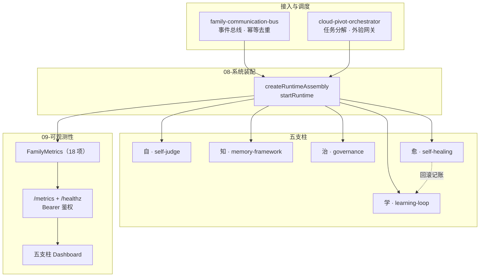
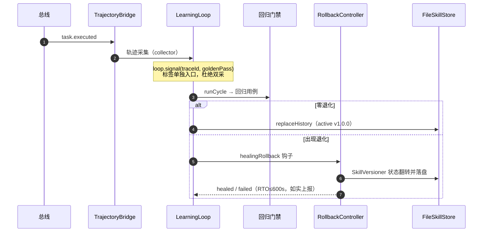

<div align="center">


# YYC³ AI Family Agent · 五支柱编程体系

### _言启象限 · 语枢未来_

**_Words Initiate Quadrants, Language Serves as Core for Future_**

_万象归元于云枢 · 深栈智启新纪元_

</div>

---

## 🏷️ 徽章

### 项目徽章

[](https://github.com/YYC-Cube/YYC3-AI-Family-Agents/actions/workflows/regression-gate.yml)


### 五支柱徽章


### 主题标签（GitHub Topics · 仓库页可视化）


> 建议同步到 GitHub 仓库 Topics（≤20 个小写连字符标签）：`multi-agent-systems` `ai-agents` `ai-family` `agent-family` `typescript` `zero-dependency` `a2a-protocol` `model-context-protocol` `agent-cards` `prompt-engineering` `co-star` `llm-orchestration` `self-healing` `observability` `event-bus` `regression-gate` `five-pillars` `enterprise-agents` `yyc3` `chinese`

---

## ✨ 项目简介

**YYC³ AI Family Agent** 是以「**自 · 知 · 学 · 治 · 愈**」五大技术支柱为主线的多智能体协作内核，采用 **TypeScript 严格模式 + 零运行时依赖** 实现，配套统一装配层与 Prometheus 可观测数据面。

| 支柱 | 核心能力 | 关键实现 |
| ---- | -------- | -------- |
| **自 · 自判断** | 结构化置信度、假设登记、偏离检测、升级决策 | `self-judge-kit` · verification-gateway 外验校准 |
| **知 · 记忆** | 七层记忆、写入策略、检索路由、一致性校验 | `memory-framework`（sensory / working / episodic / semantic / procedural …） |
| **学 · 持续学习** | 经验回流、模式提炼、技能固化、回归门禁、回滚 | `experience-reflow` · `stability-guard` · `learning-loop` |
| **治 · 治理** | 策略注册与分发、合规审计链、安全/质量治理 | `policy-registry` · `compliance-audit`（FNV-1a 链式哈希） |
| **愈 · 自愈** | 故障侦测去抖、降级熔断、一致性修复、版本回滚 | `fault-detector` · `degradation-controller` · `rollback-controller` |

**工程特征**

- **零运行时依赖**：指标、HTTP 端点、编译/回归脚本全部基于 Node 标准库
- **端到端装配**：`createRuntimeAssembly()` 一次接线「总线 → 轨迹 → 学习 → 落盘 → 回滚」
- **可观测闭环**：23 项 `family_*` 指标 → `/metrics`（Bearer 鉴权）→ 13 条告警 → 五支柱面板
- **门禁可复现**：`pnpm regression` 单命令完成编译、289 例测试、面板生成与退出码判定

---

## 🏗️ 系统架构



### 单周期数据流



---

## 🚀 快速开始

### 环境要求

| 项 | 要求 |
| --- | --- |
| Node.js | ≥ 20（使用 `node --import` 与内置 `fetch`） |
| TypeScript | `tsc` 可执行（局部或全局安装均可） |
| 包管理器 | pnpm（脚本可直接用 npm 等价命令） |

### 三条命令

```bash
# 1. 类型检查（仓库根）
pnpm typecheck          # 等价 tsc --noEmit

# 2. 全量门禁：隔离编译 → 40 个套件 → 五支柱聚合 → 面板 → 退出码
pnpm regression         # 289 例全绿；0 例跳过

# 3. 家族服务雏形（P6-A）：装载 45 技能 + MCP 处理器 + /metrics 能力供给真值
pnpm start              # 常驻（Ctrl+C 停止）；--selftest 自检（含 A2A 真实委托采样）；--selftest:llm 三闸 LLM 采样

# 3. 查看面板（自包含 HTML，无需服务器；含五支柱 + 能力供给卡片 P3-T6）
open ops/observability/pillar-dashboard/index.html

# 4. 家族契约清单（P1-T1/T2）与提示词契约（P1-T5）
pnpm manifest:check      # 清单 ↔ 8 份 agent.yaml 漂移校验
pnpm manifest:cards      # 由清单重建 assets/agent-cards/*.json
pnpm prompts:check       # 16 条提示词契约：版本回写 / CO-STAR 要素 / 孤儿扫描
pnpm mcp:tools:check     # MCP 工具目录与清单零漂移（P4-T5：45 可见，planned 归零后全量准入）
pnpm pack:plugins        # 能力包打包（P4-T6：金包 → assets/packs/；分发副本 → docs/）
pnpm pack:check          # 打包产物与源零漂移（确定性 ZIP · 同输入恒同字节）
```

> `pnpm regression` 不会污染工作区：临时编译目录在系统 temp 下创建并自动清理；`YYC3_KEEP_TMP=1` 可保留用于调试。

### 运行时接入（部署侧示例）

```ts
import { startRuntime } from './architecture-kernel/08-系统装配/runtime-entry.js';

const runtime = await startRuntime({
  storeDir: process.env.YYC3_SKILL_STORE_DIR ?? './data/skills',
  port: Number(process.env.YYC3_METRICS_PORT ?? 9464),
  authToken: process.env.YYC3_METRICS_TOKEN, // 设置即启用 Bearer 鉴权
  consistencySource: gateway.consistencyTracker, // 可选：一致性快照定时上报
});

// ... 运行期：runtime.assembly.bus.publish(...) / runtime.assembly.handleSignal(...)
await runtime.stop(); // 幂等
```

环境变量：`YYC3_SKILL_STORE_DIR` · `YYC3_METRICS_PORT` · `YYC3_METRICS_HOST` · `YYC3_METRICS_TOKEN` · `YYC3_CONSISTENCY_INTERVAL_MS` · `YYC3_EXEMPLARS_ENABLED`

LLM（P1）：`ZHIPU_API_KEY` / `OPENAI_API_KEY` 仅从环境变量读取（禁止入库/日志）；两家 provider 共用 `shared-core/llm-adapter` 的 OpenAI 兼容客户端（超时、指数退避、SSE 流式），成员目录下为薄转发。

---

## 📁 目录结构

```text
YYC3-AI-Family-Agent/
├── architecture-kernel/          ← 内核（编号顺延）
│   ├── 01-九层架构分层底座/
│   ├── 02-云枢核心引擎/          ← 总线 · 编排 · 外验网关 · 全局态势
│   ├── 05-持续学习引擎/          ← 经验回流 · 技能固化 · 稳定守卫
│   ├── 06-治理中心/              ← 策略注册 · 合规审计 · 安全/质量治理
│   ├── 07-自愈中心/              ← 侦测 · 降级熔断 · 一致性修复 · 回滚
│   ├── 08-系统装配/              ← createRuntimeAssembly · startRuntime
│   └── 09-可观测性/              ← 指标注册器 · FamilyMetrics · /metrics
├── family-agents/           ← 8 位家人实例与 shared-core
│   ├── core-layer/  business-layer/
│   └── shared-core/              ← self-judge-kit · memory-framework
├── assets/ · configs/ · presets/  ← 资源 / 配置 / 家人预设
├── docs/                         ← 架构设计 · 验收报告 · 接线指导 · L7/L8 计划
├── ops/                          ← Prometheus 规则/抓取 · 面板 · k8s · docker
├── public/                       ← 品牌素材与多平台图标（yyc3-family.png）
├── scripts/                      ← 回归门禁 · 指标推送 · 成员脚手架
├── tests/                        ← unit / integration / e2e / 契约 / 回归基线
├── .github/workflows/            ← regression-gate（typecheck + 门禁）
└── package.json · tsconfig.json
```

---

## 📊 可观测与门禁

### 指标（21 项运行期）

| 类别 | 指标 | 类型 |
| ---- | ---- | ---- |
| 任务与总线 | `family_task_executed_total` · `family_task_execution_duration_seconds` · `family_trajectory_bridge_events_total` | Counter / Histogram |
| 学习 | `family_learning_cycles_total` · `family_learning_promoted_total` · `family_learning_rolled_back_total` · `family_learning_regression_failed_cases` | Counter / Gauge |
| 自判断 | `family_selfjudge_agreement_ratio` · `family_selfjudge_mirage_total` | Gauge |
| 记忆 | `family_memory_retrieval_duration_seconds` | Histogram |
| 自愈 | `family_healing_actions_total` · `family_healing_rto_seconds` · `family_healing_contract_met` · `family_circuit_state` | Counter / Gauge |
| 人机协同（P1-T4，T4b 已接线生产链路） | `family_collaboration_clarify_rate` · `family_collaboration_human_confirm_rate` · `family_collaboration_trace_coverage` · `family_collaboration_replay_coverage` | Gauge（0..1） |
| 能力供给（P2 生态外挂 §6.3，已接线生产链路） | `family_capability_skills_loaded_total` · `family_capability_mcp_tool_calls_total` · `family_capability_plugin_denied_total` | Counter |

> 五维归属（时间 3 / 空间 2 / 属性 4 / 事件 4 / 关联 3，另 4 项协同度、3 项能力供给单列）见 [`assets/schemas/five-dimension-map.json`](assets/schemas/five-dimension-map.json)；面板以「五维覆盖」卡片呈现。

**告警（13 条）**：P99 延迟 · 失败率 · 校准漂移 · 记忆检索 P95 · 学习回归失败 · 回归门禁失败 · 五支柱红牌 · 澄清率过高 · 人工确认率过低 · traceId 覆盖率过低 · 复盘覆盖率过低 · 能力包准入拒绝 · LLM 输出填充率过低。规则见 [`ops/observability/prometheus-rules.yaml`](ops/observability/prometheus-rules.yaml)。

**Exemplars（L7，默认关闭）**：设置 `YYC3_EXEMPLARS_ENABLED=1` 后，`/metrics` 支持 OpenMetrics 1.0，直方图落点桶附带 `trace_id`，可在 Grafana 从 P95/P99 直接下钻到 trace。默认关闭时输出与 v2.7.2 完全一致，不注册 `family_exemplars_dropped_total`。

### 门禁口径

| 项 | 结果 |
| --- | --- |
| 全量用例 | **238 / 238 通过** |
| 显式跳过 | **0 例**（EventBus DLQ 已实现） |
| 静默套件 | **0** |
| 五支柱 | 自 28 · 知 51 · 学 87 · 治 77 · 愈 49 |
| 类型检查 | `tsc --noEmit` exit 0 |

**LLM 实答 UAT（本地门控，默认跳过，不计入门禁）**：`pnpm uat:llm` 以真实 Key 对开放平台做身份与意图抽检（1 身份 + 4 意图，附规则主选对照）。三重门控（`UAT_LLM=1` + `UAT_LLM_CONFIRM=我知晓真实计费` + 密钥存在）缺一整体跳过且 exit 0：

```bash
UAT_LLM=1 UAT_LLM_CONFIRM='我知晓真实计费' ZHIPU_API_KEY=<你的Key> pnpm uat:llm
```

---

## 🔌 模块接线状态

> 口径：从 40 个门禁入口做静态 import 可达性分析（相对导入 + `@shared` 别名 BFS，P5 后统一刷新为纯可达口径）；**「仅编译」不代表已交付能力**。

| 范围 | 编译文件 | 已接线 | 仅编译 |
| ---- | -------- | ------ | ------ |
| `architecture-kernel` | 115 | 64 | 51 |
| `family-agents` | 150 | 36 | 114 |
| `tests`（门禁入口） | 40 | 40 | 0 |
| **合计** | **305** | **140** | **165** |

- `shared-core` 记忆 / 学习 / LLM 主链路全接线（llm-adapter barrel 与 8 位家人薄转发 provider 属部署侧消费，计仅编译）；家人意图链路 4 文件 + 伯乐成就面板已接线
- `01-九层架构分层底座` 20/20 为**契约骨架**，尚未接线
- 8 个家人自测 spec 被 `tsconfig` 排除且不在回归清单；另有 2 个 UAT 门控 spec（`uat:llm` / `uat:external`）在编译范围但不作门禁入口，不纳入本表

完整明细（含每个文件职责、状态、计划阶段、标准与规范五维矩阵）见 **[未接线模块清单](docs/YYC3-AI-Family-Agent-未接线模块清单.md)**。

---

## 📚 文档

| 文档 | 内容 |
| ---- | ---- |
| [架构设计](docs/YYC3-AI-Family-Agent-架构设计.md) | 五支柱定义、九层底座、§8.3 版本变更（至 v2.11.0） |
| [P0 可观测数据面验收报告](docs/YYC3-AI-Family-Agent-P0可观测数据面验收报告.md) | 7 项 AC 实证、五维评估、遗留项闭环（v1.2.0） |
| [装配层接线指导](docs/YYC3-AI-Family-Agent-装配层接线指导.md) | infra-1～4 分步接线、双采陷阱、适配器代码 |
| [L7 / L8 落地计划](docs/YYC3-AI-Family-Agent-L7-L8落地计划.md) | Exemplars 方案 A · Git 基线 · 步骤/测试/验收/回滚 |
| [未接线模块清单](docs/YYC3-AI-Family-Agent-未接线模块清单.md) | 接线状态盘点 · 骨架与已交付边界 · 标准规范五维矩阵 |
| [CONTRIBUTING.md](CONTRIBUTING.md) | 分支、PR、提交规范、质量门禁、文档规范 |
| [CODE_OF_CONDUCT.md](CODE_OF_CONDUCT.md) | 行为准则与处理阶梯 |
| [SECURITY.md](SECURITY.md) | 漏洞报告、支持版本、部署安全基线 |
| [CHANGELOG.md](CHANGELOG.md) | 版本变更记录 |

---

## 🔖 仓库标签（GitHub Topics）

```text
ai-agents · multi-agent-systems · ai-family · yyc3 · typescript · nodejs
llm · agent-orchestration · ai-governance · guardrails · self-healing
observability · prometheus · memory-framework · rag · zero-dependency
mcp · pnpm · dashboard · human-ai-collaboration
```

一键设置：

```bash
gh repo edit YYC-Cube/YYC3-AI-Family-Agents \
  --add-topic ai-agents --add-topic multi-agent-systems --add-topic ai-family \
  --add-topic yyc3 --add-topic typescript --add-topic nodejs --add-topic llm \
  --add-topic agent-orchestration --add-topic ai-governance --add-topic guardrails \
  --add-topic self-healing --add-topic observability --add-topic prometheus \
  --add-topic memory-framework --add-topic rag --add-topic zero-dependency \
  --add-topic mcp --add-topic pnpm --add-topic dashboard \
  --add-topic human-ai-collaboration
```

**中文关键词**：五支柱 · 自·知·学·治·愈 · AI 家人 · 治理中枢 · 自愈 · 可观测 · 记忆框架 · 持续学习 · 零依赖 · 参数护栏 · 人机协同

---

## 🗺️ 路线图

| 阶段 | 状态 | 内容 |
| --- | --- | --- |
| Phase A–C | ✅ 完成 | 程序化记忆 · 自评-外验闭环 · 经验回流 |
| 三支柱贯通 | ✅ 完成 | 自 → 治 → 学 数据流冒烟（v2.4.1） |
| Phase D/E | ✅ 完成 | 治/愈转实 · 知识更新 · 参数护栏（v2.5.0） |
| P0 可观测 | ✅ 完成 | 指标 → /metrics → 告警 → 面板（v2.7.0–v2.7.2） |
| **L7 Exemplars** | ✅ 完成 | OpenMetrics 下钻（v2.8.0，默认关闭） |
| **L8 Git 基线** | ✅ 完成 | 远端 main + 标签 + CI 门禁 + 分支保护 + Release v2.8.0 |
| **P1 真实 LLM** | ✅ 完成 | 智谱 + OpenAI 共用兼容客户端；千行意图链路（分类 → 路由 → CAGEERF 分解）e2e 4 例 |

---

## 📄 许可与声明

本项目以 **MIT License** 开源（详见 [LICENSE](LICENSE)），允许使用、修改、分发与商业使用，须保留版权与许可声明。

**商标声明**：`YanYuCloudCube`、`YYC³`、`YYC³ AI Family` 及 8 位家人的名称与形象标识为品牌资产；MIT 许可不授予商标使用权。

**安全**：漏洞请勿公开披露，见 [SECURITY.md](SECURITY.md)。

<div align="center">

> 「***YanYuCloudCube***」言启象限 | 语枢未来
> 「***Words Initiate Quadrants, Language Serves as Core for the Future***」
> 「***All things converge in cloud pivot; Deep stacks ignite a new era of intelligence***」

**© 2025-2026 YanYuCloudCube™. All Rights Reserved.**

</div>
